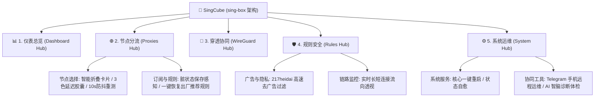

> [!IMPORTANT]
> # 📢 MiCube & SingCube 归档与演进公告：当“宗教辩论”催生出的终极魔方
>
> 大家好！
>
> 首先，向一直以来把玩 **MiCube**（Mihomo 内核）与 **SingCube**（sing-box 内核）的每一位硬核玩家致以最诚挚的谢意。
>
> 回顾过去这段时间，我的朋友圈简直变成了大型**“软路由当代宗教辩论修罗场”**：
>
> * ☕ **Mihomo 派信徒**：天天端着保温杯，笃信世间万物皆可被复杂的嵌套策略组与几十万条正则规则统治；手里握着几百个备用节点，选路容差精确到毫秒，眼里容不下一粒沙子：*“没有精细化分流与故障转移的网关，是没有灵魂的算力废铁！”*
> * ⚡ **sing-box 派极速党**：信奉极致的内存唯快不破、纳秒级的冷启速度与最前沿的现代化协议；在他们眼里，配置里多占用 1MB 内存都是对内心的背叛：*“能用极简 JSON 和纯粹内核搞定的事，为什么要套娃十层 YAML？”*
>
> 两拨朋友在群里和朋友圈里为了“到底谁才是软路由真神”吵得面红耳赤，辩论激烈程度差点连路由器的散热片都给掀翻了。
>
> 作为这两个项目的维护者，我当时陷入了沉思：**我们为什么要逼大家做选择题？成年人的世界，难道不是应该——“我 全 都 要”吗？！**
>
> 为了彻底平息两派玩家的“内耗”，让大家放下键盘开心喝茶，我们索性把这两个项目原地进行**基因级融合与全面重构**，正式推出跨世代终极旗舰项目——**CubeX（极光魔方）**！
>
> ---
>
> ### 🚀 我们在 CubeX 中终结了什么，又带来了什么？
>
> 1. **⚡ 双擎共生，零断流毫秒级热切（Make-Before-Break）**  
>    在 CubeX 中，Mihomo 与 sing-box v1.14.3+ 融为一体。顶栏常驻毫秒级切换胶囊，不重建防火墙、不断开存量长连接，选中的出口节点状态自动无缝手递手（Handoff）。不仅如此，我们还顺手做了一个**「双核同节点 AB 竞技场」**：同一节点同时让 M 核与 S 核同台狂飙，TCP 握手、TLS 开销与内存占用实时同屏对决，让数据说话！
>
> 2. **🖥️ 宿主机底座全面打通，智能自适应识别**  
>    拒绝割裂！CubeX 彻底告别繁琐代码，全自动嗅探底层宿主系统：
>    * 🔷 **MikroTik RouterOS v7** 容器联动（自动探查 IP Cloud 免费动态域名、自动下发策略路由表 `table 8228`、Netwatch 0秒逃生）
>    * 🟢 **飞牛 fnOS 专属底座**（Debian 12 内核优化）
>    * 🟠 **Proxmox VE (PVE)** LXC / 💻 **通用 Linux Docker**  
>    内核数据包转发（`ip_forward=1`）与防火墙放行规则支持**一键智能打通**，无论新手还是老鸟，插上电就是终极旁路由。
>
> 3. **📡 WireGuard 穿透双端硬件级对齐 & 设备分流矩阵**  
>    外网手机官方 WireGuard App **一键扫码秒连家庭内网**，内置 5 项对齐矩阵体检；针对局域网特定终端（家庭影院蓝光机、PT 下载机、Apple TV、PS5），提供直观的三段式胶囊滑块：  
>    `🟢 智能规则分流` ⇄ `🔵 底层直连绕过 (专为蓝光机 SMB1 准备)` ⇄ `🟣 绑定死特定出口`。
>
> 4. **🛡️ 217heidai 权威规则与严格 0 明文 DNS 泄露**  
>    内置 233,481 条高精度离线 MRS 去广告规则集，Fake-IP 智能剥离，国内真实公网 IP 直连直出，杜绝 ISP 劫持与 DNS 污染。
>
> 5. **🚀 四维版本在线热更矩阵**  
>    拒绝繁琐手动敲命令行：**CubeX 主控守护、Mihomo 内核、sing-box 内核、全量 Geo/MRS 规则数据库、宿主机底座系统包**，全部支持在面板上一键检测与无损热更。
>
> ---
>
> ### 📌 后续归档安排与全新起航
>
> * 📦 **状态变更**：本仓库自即日起正式进入**只读归档状态（Archive / Read-only）**，历史代码与讨论将永久保留以供查阅。
> * 🌌 **全新起航**：所有后续功能演进、Bug 修复及镜像构建，均已全面转移至全新合体主仓库：  
>   👉 **[zyeyefyass/CubeX (GitHub)](https://github.com/zyeyefyass/CubeX)**
>
> 感谢每一位朋友在 MiCube 和 SingCube 探索期给予的包容、批评与宝贵建议。没有你们当年的激烈争论和极致挑剔，就不会有今天这颗毫无妥协的 CubeX。
>
> “圣战”已经结束，魔方已经拼好。欢迎移步新家，继续回来**“开箱”与“开机”**！
>
> —— **zyeyefyass & CubeX 核心团队**  
> *2026年10月*
>
> ---

<p align="center">
  
</p>

<h1 align="center">SingCube · 赛博极光高可用旁路由网关系统</h1>

<p align="center">
  <b>基于 sing-box 顶级内核的现代微型单二进制透明网关系统</b><br/>
  <b>专为 MikroTik RouterOS v7、飞牛私有云 (fnOS)、Proxmox VE、群晖 Synology 与各类 NAS/软路由量身定制</b>
</p>

<p align="center">
  <a href="https://github.com/zyeyefyass/SingCube/releases"></a>
  <a href="#"></a>
  <a href="#"></a>
  <a href="#"></a>
  <a href="#"></a>
</p>

---

## 🌟 为什么选择 SingCube？

**SingCube** 是基于 **sing-box** 最新稳定架构打造的独立旗舰平行分支。在继承主线版本 5 大中心极简导航、RouterOS v7 原生联动、严格防 DNS 泄露与全自动 WireGuard 穿透的同时，全面拥抱 **Cyber Aurora Purple & Emerald（赛博极光深紫黑与翡翠荧光）** 现代深空美学，并将常驻内存进一步压制到极限的 **35MB ~ 45MB**！

- 💎 **纯 Go 原创自研单二进制架构**：内置 Vue 3 + Tailwind CSS 响应式控制台，零外部环境依赖；
- ⚡ **sing-box 极速内核底座**：原生支持 TUN SystemStack 协议栈，多路复用与零拷贝转发，延迟低至极限；
- 🛡️ **严格防 DNS 泄露体系**：内置分流级加密 DNS (`dns_direct` + `dns_proxy` + `dns_block`)，杜绝任何明文回退；
- 🌐 **国内流量直连剥离 Fake-IP (Real-IP 直出)**：国内大厂域名直出真实公网 IP，BT/PT 满载下载不占用旁路由 CPU；
- 📦 **兼容 Clash RESTful API**：通过 sing-box `experimental.clash_api`，节点延迟测速、实时流量波形与链路诊断无缝响应；
- 🚀 **国内网络 0 门槛秒级装配**：原生集成 CDN 加速与离线 tar 包秒级载入，**没有科学上网环境也能一键顺利装配**。

---

## 🧭 五大中枢核心功能架构 (5-Hub Navigation)

SingCube 界面严格遵循 Executive 极简布局，将全功能精炼整合为 **5 大中枢**：



---

## 🚀 极速安装与部署全指南

为确保在任何网络环境（无论是否有代理）都能 100% 安装成功，SingCube 提供以下全流程方案：

### 🌟 方案一：Docker / 飞牛 fnOS / PVE LXC / Linux 一键安装

#### 1. 单行命令一键部署 (自动识别架构与网络环境)

- **⚡ 航道 A：国内无代理 / 直连网络环境（自动匹配国内高速 CDN 镜像源）**：
  ```bash
  curl -fsSL https://ghfast.top/https://github.com/zyeyefyass/SingCube/releases/download/Test-V0.91/install.sh | sh
  ```

- **🌐 航道 B：具备国际网络加速环境**：
  ```bash
  curl -fsSL https://github.com/zyeyefyass/SingCube/releases/download/Test-V0.91/install.sh | sh
  ```

---

#### 🌟 纯离线 0 流量导入法 (国内弱网环境首选 · 100% 成功)

如果您处于内网隔离环境或外网拉取受阻：
1. 前往 Releases 页面下载两个文件：
   - `install.sh`
   - `SingCube-amd64.tar` *(ARM 架构请下载 `SingCube-arm64.tar`)*
2. 通过局域网共享 (SMB)、飞牛私有云文件管理或 WinSCP 将这两个文件放到服务器的同一目录下；
3. 打开服务器终端运行：
   ```bash
   chmod +x install.sh && ./install.sh
   ```
   **脚本检测到本地离线包后，直接执行 `docker load -i` 秒级载入，全程 0 字节外网下载，3 秒即刻满血启动！**

---

### 📜 方案二：MikroTik RouterOS v7 终端一键初始化 (`install-routeros.rsc`)

专为 **MikroTik CCR / RB / hEX / CHR / x86** 设备的 RouterOS v7 Container 容器环境定制：

1. 下载 `install-routeros.rsc` 与 `SingCube-amd64.tar`；
2. 打开 WinBox -> 进入【Files】菜单，将文件拖入扩展存储盘（如 `disk1`）；
3. 打开 WinBox 顶部【Terminal】终端，执行命令：
   ```routeros
   /import disk1/install-routeros.rsc
   ```
4. 容器构建完成后，浏览器打开 **`http://192.168.88.3:2026`**（或您指定的 IP）进入控制台。

---

### 📜 方案三：Docker Compose 一键编排

在项目目录创建 `docker-compose.yml`：
```yaml
services:
  singcube:
    image: ghcr.io/zyeyefyass/singcube:latest
    container_name: singcube
    restart: always
    network_mode: host
    privileged: true
    devices:
      - /dev/net/tun:/dev/net/tun
    volumes:
      - ./data:/opt/SingCube/data
      - ./etc:/opt/SingCube/etc
    environment:
      - TZ=Asia/Shanghai
      - PORT=2026
```
启动命令：
```bash
docker compose up -d
```

---

## 🧭 默认端口与网络监听规范

| 端口号 | 协议 | 功能用途 | 说明 |
| :--- | :--- | :--- | :--- |
| **`2026`** | TCP | SingCube Web 控制台 | 支持电脑端与手机端响应式交互 |
| **`53`** | UDP/TCP | DNS 防泄露网关 | 局域网设备填写本机 IP 为 DNS 即可享受分流防泄露 |
| **`7890`** | TCP | 本地混合代理 (Mixed) | 支持 HTTP(S) 与 SOCKS5，方便本地测试 |
| **`9090`** | TCP | sing-box Clash API | 供前端与外部第三方客户端联动调用 |

---

## 🔒 净室自研与知识产权合规申明

- **100% 原创自研**：SingCube 为独立闭源自研网关系统，严格剥离旧版命名空间；
- **配置与数据安全**：所有订阅链接与规则仅在用户本地数据库加密处理，绝不上传任何云端服务器。
